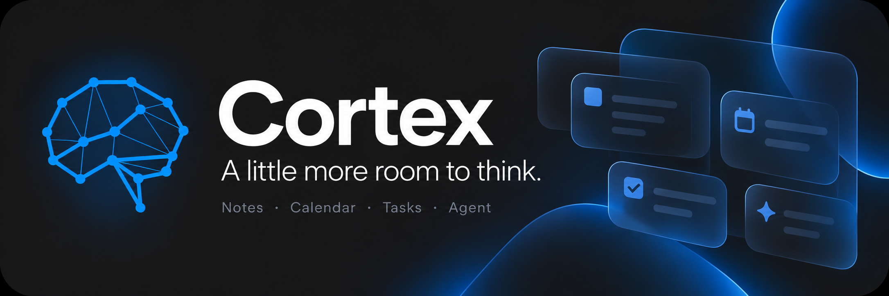
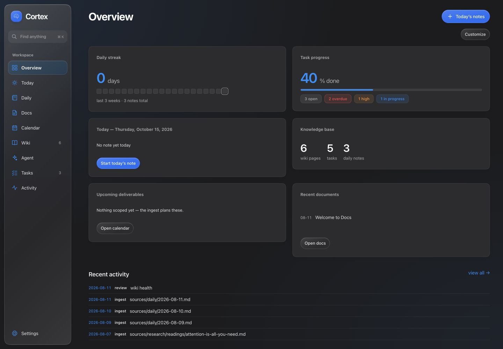
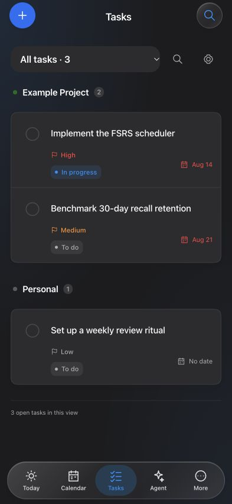
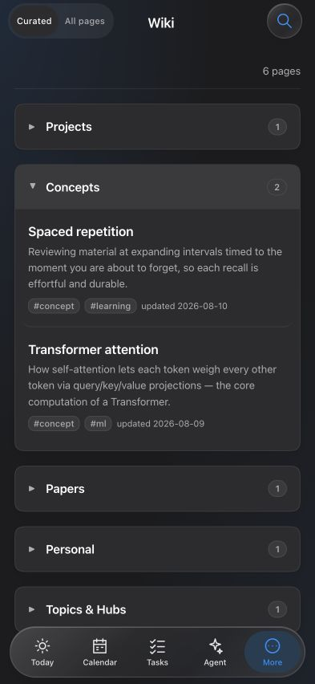
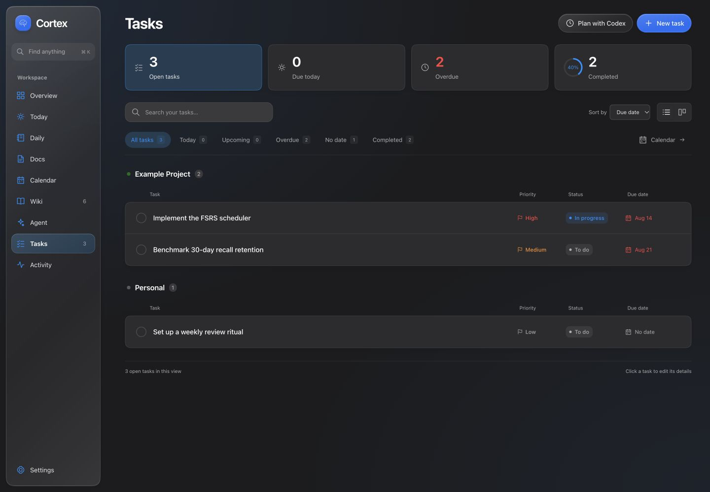

[](https://cortex-workspace.sassygnome16.chatgpt.site)

An open-source workspace for your notes, calendar, tasks, and a wiki-grounded Codex assistant. Apple Dark by default, with responsive desktop and phone layouts.

**[Explore the showcase](https://cortex-workspace.sassygnome16.chatgpt.site)** · **[Setup & deployment](web/DEPLOY.md)** · **[Connect Codex](tooling/cortex-codex-bridge/README.md)** · **[Feature guide](docs/FEATURES.md)**

Cortex brings raw capture → connected knowledge → scheduled action into one workspace. Your source notes and synthesized wiki stay in Markdown. The public repository contains application code, an empty starter, and fictional demo content—not a personal vault. The showcase is a static site, not a shared Cortex instance.

## Quick start

Requires Node.js 22+ and npm.

```sh
git clone https://github.com/AnikethCheluva/cortex.git
cd cortex/web
npm ci
npm run dev
```

Open http://localhost:3000. No account, AI key, or database is required for the local starter. Calendar and Codex features need your own connections.

To explore the fictional demo, run from the repository root:

```sh
node scripts/use-vault.mjs examples/demo-vault
cd web
npm run dev
```

For your own content, keep a **separate private vault** outside this public checkout:

```sh
node scripts/use-vault.mjs /absolute/path/to/your-private-vault
```

This writes a gitignored local setting. Cortex never automatically reads a parent directory. Do not copy your real notes into the examples directories: those are tracked public fixtures.

## A look inside

Real app captures in Apple Dark, using only the bundled fictional demo vault.

**Desktop — room for the whole picture.**

[](docs/images/app-desktop-overview.jpg)

**On your phone — tasks and knowledge, within reach.**

<p>
  <a href="docs/images/app-phone-tasks.jpg"></a>
  &nbsp;
  <a href="docs/images/app-phone-wiki.jpg"></a>
</p>

<details>
<summary>See the desktop task workspace</summary>

Priorities, progress, and planning in one view.

[](docs/images/app-desktop-tasks.jpg)

</details>

## What’s inside

| Area | Features |
| --- | --- |
| Today & Overview | Single-column daily capture, voice notes, task progress, configurable overview widgets and cards |
| Calendar | Google + Outlook, per-event colors, meeting links, day/3-day/week/month/agenda views, continuous day-snapped scrolling, cached event ranges |
| Phone calendar | Compact week-snapped month dropdown, header follows the browsed month, calendar-source dropdown, date-number Today button, bottom event sheet with Join meeting |
| Tasks | List and board views, priorities, due dates, estimated minutes, inline updates, filters, compact mobile actions |
| Auto timebox | Codex-assisted duration estimates, priority-aware placement around busy events, explicit deadline handling, inferred due dates when missing |
| Agent | Separate conversations, chat history, wiki context attachments, pinned pages, slim composer, grounded answers |
| Command-K | Workspace search, automatic search/prompt intent detection, inline agent answers, supported commands including timeboxing |
| Docs | Paper-style rich editor, Markdown storage, LaTeX equations, formatting controls, folders with Finder-inspired icons |
| Wiki | Curated and A–Z browsing, tags, backlinks, source references, global search, pin-to-Agent |
| Recall & Activity | Spaced-repetition quizzes, grading/scheduling tools, charts, change history and diffs |
| Appearance | Apple Dark / Apple Light plus additional palettes, system typography, glass controls, reduced-motion support |
| Integrations | Calendar reconnect in Settings, Notion import, optional transcription provider, Raycast, Shortcuts, Slack capture tooling |

On phones, centered headers, floating search, compact menus, and a floating tab bar keep the content in focus. The tab bar hides while typing. See the [full feature guide](docs/FEATURES.md) for behavior and limits.

## Connect your own Codex account

The optional local companion talks to [`codex app-server`](https://developers.openai.com/codex/app-server/) using the Codex account signed in on your machine. It sends the selected context to Codex for answers or structured estimates. Your plan’s Codex eligibility and usage limits apply; a ChatGPT subscription does **not** provide an OpenAI API key or API credits.

The companion is restricted to answering and estimating. Cortex performs its supported UI actions and schedule writes. It is not an unrestricted remote terminal. Read the [companion setup guide](tooling/cortex-codex-bridge/README.md).

## Keep your workspace private

- Keep your vault in a separate **private repository** or local directory. Keep tokens and credentials in environment variables.
- For hosted private data, configure `APP_PASSWORD` or allowlisted Google login, or put the **entire deployment** behind an access proxy. A hard-to-guess URL is not access control.
- Server rendering checks the session before loading vault content; data GET routes and write APIs enforce configured authentication. With no authentication configured, the app is open—use that only locally or with synthetic data.
- Calendar, chat history, and context selections use browser storage. Use a trusted browser profile; they are not automatically synchronized across devices.
- The optional Convex mirror requires its own authenticated identity and email allowlist. The app password cookie is not a Convex credential. Leave it disabled unless you implement that separate authentication connection.
- Do not publish `.env` files, bridge state, private screenshots, or personal vault exports. The public-content check catches common mistakes but is not a substitute for reviewing your outgoing diff.

See [privacy and deployment](web/DEPLOY.md). The landing-page workflow uploads **only `site/`**, never the application or a vault.

## Project layout

```text
web/                         Next.js application
site/                        Static Apple Dark showcase (GitHub Pages)
tooling/cortex-codex-bridge/  Optional local Codex companion
clients/                     Raycast and iOS integrations
tooling/slackbot/             Optional capture tooling
examples/vault/              Empty starter and templates
examples/demo-vault/         Fictional demo content
scripts/                     Vault selection and public-content checks
```

The knowledge workflow is described in [CLAUDE.md](CLAUDE.md). Source files are captures; the wiki is a derived layer. Agent chat does not automatically compile your whole wiki—use the repository’s ingest workflow for that.

## Development

```sh
cd web
npm test
npm run build
# From the repository root:
node --test tooling/cortex-codex-bridge/*.test.mjs
node scripts/check-public.mjs
python3 -m http.server 8080 --directory site
```

The showcase has no analytics, account connection, or runtime data API. All visible examples are fictional. Apple and Notion references describe interface inspiration; Cortex is an independent project.

MIT licensed. See [LICENSE](LICENSE).
